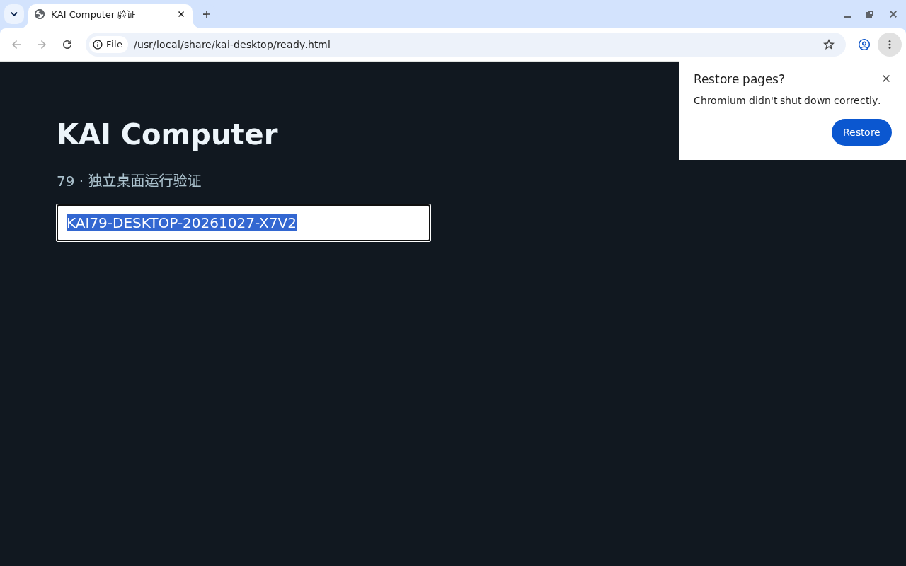

# Computer V1：79 的独立 VM、浏览器与终端验证

2026-10-27，北京时间。接续[镜像升级底座](assistant-computer-images-20261027.md)。79 已实际运行独立 KVM guest，并验证浏览器与受控终端可在同一 VM 共存、整机重启后数据保留。本轮是隔离能力验证，**没有将本人正式电脑迁入 VM，也没有上线 KAI 桌面入口或人工接管**。

## 实际环境

宿主仍为原 3.10 内核。使用私有 QEMU 容器运行 Debian 12 guest，guest 实际内核为 `6.1.0-54-cloud-amd64`。没有放宽宿主用户命名空间、修改宿主 KVM 设备权限或使用 Chromium `--no-sandbox`。

| 项目 | 实测配置 |
| --- | --- |
| QEMU runner | `kai/computer-vm-runner:20261027-v2` |
| 固定 image ID | `sha256:f6ff82bbfc167157aca72e14a0812eb8aa2dad47dbe7405d12e9180273be9b70` |
| 宿主进程身份 | UID/GID 28010，CapEff 0、NoNewPrivs 1、Seccomp 2 |
| 外层限制 | 只读 rootfs、cap_drop ALL、非 privileged、6 GiB / 2 CPU / 128 pids |
| Guest | 2 vCPU、4 GiB RAM、20 GiB qcow2 overlay，独立虚拟内核 |
| 浏览器与显示 | Chromium 156.0.8078.47、Xvfb、Openbox、x11vnc |
| 身份边界 | 任务 UID 28000；桌面 UID 28001；私有管理员只用于验证 |
| 唯一主机映射 | `127.0.0.1:22079 → guest SSH`，固定主机公钥校验 |

宿主 `/dev/kvm` 保持 `root:root 0600`。为 runner 创建私有、同一设备号的设备 inode，再按 `rw` 映射，QEMU 全程使用非 root 身份。管理员 SSH 私钥未挂入 runner。见[宿主运行记录](results/assistant-computer-desktop-vm-20261027/host-runtime.json)、[镜像 ID](results/assistant-computer-desktop-vm-20261027/runner-image.json)。

Base 使用 Debian 官方 Bookworm cloud image，334 MiB，发行方 SHA-512 为：

```text
0464b5d4ae3aa4f658468d88da83af7857b71548b30d46dcb6282770955a747fb95a983476db90d25afd0653af607224c7ebd05122ab71faa106fd712aaad652
```

实际下载与校验记录见[cloud-image.json](results/assistant-computer-desktop-vm-20261027/cloud-image.json)。来源：[Debian 官方目录](https://cloudfront.debian.net/cdimage/cloud/bookworm/latest/)。`latest` 可能变化，后续必须重新验证，而不能沿用文件名判断版本。

NoCloud seed 以只读 virtio block 连接，guest 确认 `DataSourceNoCloud [seed=/dev/vdb]`，初始化完成并通过预设主机公钥登录。IDE CD-ROM 的首轮未发现 seed，因此最终配置固定使用 virtio。参考 [cloud-init NoCloud](https://docs.cloud-init.io/en/latest/reference/datasources/nocloud.html)。

## 浏览器与桌面验证

`chrome://sandbox` 实际返回 Layer 1 Namespace、PID / Network namespaces、Seccomp-BPF 与 TSYNC 为启用；另核对真实桌面 renderer 的 PID namespace 与浏览器主进程不同、Seccomp 2、无 capabilities、NoNewPrivs 1。没有仅凭启动参数推断沙箱成功。

完整诊断也保留 Yama Non-broker 为 No 的实际值，没有把所有项目写成全绿。Headless 自检使用独立测试 profile；真实桌面进程另行核对。[初次结果](results/assistant-computer-desktop-vm-20261027/guest-probe-before.json)、[最终开机结果](results/assistant-computer-desktop-vm-20261027/guest-probe-after.json)。读取内部页面使用 Chrome 官方提供的 [headless CLI](https://developer.chrome.com/docs/automation-and-testing/headless-cli) 参数，没有开放网络 CDP。

普通任务账号实际不能读取桌面 profile、Xauthority、浏览器环境，不能向浏览器发信号或连接 X11，也不能 sudo。VNC 握手不允许 None 认证，服务仅监听 guest localhost，主机未映射 VNC 端口。此时仍是私有验证服务，尚无 KAI 账号代理和 GUI 互斥租约。

公开测试页在真实桌面输入 `KAI79-DESKTOP-20261027-X7V2`，通过输入框复制再读回，而非读取预先放置的文本文件。随后正常关机、替换 QEMU 容器，再正常关机并重新启动，三次已验收的 guest boot ID 分别为：

| 阶段 | Boot ID |
| --- | --- |
| 初次浏览器验收 | `1612db01-776b-4c73-88ea-1770b8258a27` |
| 替换 runner 容器后 | `056a2cc3-3ca6-4d9e-8779-af90a659c520` |
| 再次整机启动后 | `746a3992-e55a-467a-98e0-a5b045558e2e` |

后两次只读取原输入框的保存值，没有重新输入代号。[第一次重建结果](results/assistant-computer-desktop-vm-20261027/guest-probe-after-recreate.json)。这证明本地浏览器数据保留；没有登录第三方网站，不能替代网站登录态或 OS keyring 验收。



正常停止时先向浏览器窗口发送关闭请求，等待原进程退出，再停止显示服务；关闭浏览器本身不会结束 Xvfb。实际退出记录为 `Normal`。早期测试留下的 crash restore 状态通过真实浏览器操作确认后清除，没有编辑 Preferences 或添加隐藏恢复提示的启动参数。[退出记录](results/assistant-computer-desktop-vm-20261027/graceful-stop.json)。

## 同一 VM 的终端与进程回收

复制现有固定监督器到 guest 管理目录并核对 SHA-256，使用 root-only spool 与 `setpriv --no-new-privs` 调用。不是模型 Run，也没有通过本轮证明 VM 的数据库 canonical 授权；报告明确记录 `canonicalAuthorizationTested: false`。

两次开机分别执行两轮实际监督器操作：

- 命令实际 UID/GID 28000，无 capabilities，NoNewPrivs 1；任务使用独立 PID/mount namespace。
- 创建并复用工作文件与 HOME 可执行脚本；后轮读取时 identity 的 mtime 没有改变。
- 普通任务看不到外部桌面进程，读取浏览器 profile 被拒绝。
- 任务自行生成 SSH key、写入自己的 authorized_keys，再进行真实 SSH 登录尝试，返回权限拒绝；guest SSH 只允许管理员，不能借 SSH 逃离 Run 进程边界。试验后还原授权文件，临时私钥不进入报告。
- 脱离终端的子进程在 deactivate 后停止写入，旧 token 返回 125，未写出拒绝测试文件。
- 回收终端 namespace 后，浏览器原 PID 仍运行，没有为证明成功重启浏览器。

见[重启前终端验证](results/assistant-computer-desktop-vm-20261027/guest-execution-before-reboot.json)、[重启后终端验证](results/assistant-computer-desktop-vm-20261027/guest-execution.json)。

整机重启前后，identity SHA-256、mtime、HOME 工具 SHA-256 与可执行模式一致。[前](results/assistant-computer-desktop-vm-20261027/continuity-before-reboot.json)、[后](results/assistant-computer-desktop-vm-20261027/continuity-after-reboot.json)。这是本轮独立 VM 的文件，不是本人正式 Computer 的工作卷。

## 正式接入的下一阶段

接下来的实现顺序需要保持现有控制协议的授权与物理停止边界：

1. 新增专用 VM backend 与显式维护迁移；不能绕过现有 Docker `verify_instance` 或仅换一个镜像名。保留本人原 work volume，先停止旧执行者，再接新环境，验证晚到旧实例、丢失回执及回退。
2. 当前 cloud kernel 明确没有 `CONFIG_NET_9P`，尚不能直接共享原工作卷。后续验证含对应驱动的 generic kernel / 镜像，再决定共享盘方案；不把单独 VM 文件复用冒充生产卷已迁移。
3. Runner 更新与 guest OS 更新分开。qcow2 overlay 引用的 base 必须保持对应版本，不允许原地替换 backing 文件来“升级系统”；需独立数据盘及可验证的快照/迁移策略。
4. Guest 控制账号采用固定命令、私有根目录授权公钥与固定 NoNewPrivs，不给任务账号通用 SSH 入口。进程身份还须加入 kernel boot 身份验证或按 boot 重建私有运行状态，不能跨内核启动沿用旧 PID / namespace 标识；数据库 epoch 与授权继续由平台持有。
5. 浏览器 profile 与普通任务身份保持分离。通过受控 GUI broker 接收结构化操作，增加用户接管与 Agent GUI 的互斥及过期回收；只改前端按钮不足以防止输入旁路。
6. 增加 KAI 账号校验、Origin 检查及会话撤销后的 HTTP/WebSocket 代理，不在 URL 下发 VNC/CDP 凭据。完成网页登录、交还 Agent、飞书发起任务、网页刷新及重连的真实验收后，才切换本人试点。

本轮没有使用 VM fixture 的管理员密钥作为未来生产控制凭据，也没有将其写进基础镜像。网络策略、网站登录与 keyring 仍需在正式 backend 接入时单独验证。

## 代码、检查与清理

新增 [runner 与 compose](../deploy/assistant-79/computer-vm/README.md)、guest 桌面安装脚本，以及两个有明确隔离 hostname 限制的验证脚本。六份实际执行/构建源与仓库 SHA-256 一致。[源核对](results/assistant-computer-desktop-vm-20261027/source-verification.json)。Dockerfile 默认使用已核对 ID、包含 CA 的 79 Debian 12 base；默认参数完整构建得到与实际验收完全相同的固定 image ID。[默认构建](results/assistant-computer-desktop-vm-20261027/default-build.json)。两份 Python 脚本 Ruff 通过、Pyright 0 错误/警告，shell 语法与 compose 配置验证通过。[检查记录](results/assistant-computer-desktop-vm-20261027/static-checks.json)。

生产配置与 r21 发布配置一致，schema 仍为 0051；API、Worker、Computer Node、Web、HTTPS、存储均正常，飞书/微信接收器运行中。本人 `computer_76649d1de93843289142040974d587f9` 仍为原实例、原镜像和原工作卷。[正式环境核对](results/assistant-computer-desktop-vm-20261027/production-unchanged.json)。没有为本轮能力验证修改绑定或聊天记录。

验收后 guest 正常关机，移除本轮 VM 容器以释放 CPU/RAM，保留私有磁盘和固定 runner 镜像便于后续接入验证。没有删除正式工作盘。[清理记录](results/assistant-computer-desktop-vm-20261027/cleanup.json)。完整 Computer V1 与后续助理能力仍按[整体方案](plans/2026-10-27-assistant-dot-bot-computer.md)继续。
