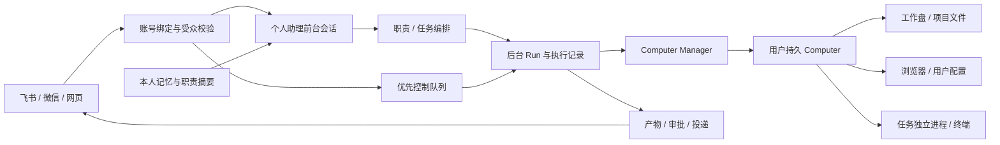

# KAI 常驻助理：Dot / Grok Bot 差距与持久 Computer 方案

日期：2026-10-27，北京时间。基于本仓库代码、79 实际部署及下列官方资料。公开文档只能确认产品行为，不能证明闭源产品的内部数据库、调度协议或源码实现。文中的 KAI 架构是设计建议。

## 结论

KAI 已有飞书、微信、网页本人私聊共用会话，支持图片、文件、语音、组合消息。主要差距在常驻助理编排与执行环境生命周期：同一助理需要持续工作机、前台对话与后台任务分离、可干预的运行、长期记忆与有证据的结果交付。

Dot 在官方文档中属于 ChatGPT 的常驻助理体验，可以委派 Work / Codex 任务。它拥有云端电脑，连接个人电脑是另一个权限入口。[Dot 概览](https://learn.chatgpt.com/docs/dots)

Grok Bot 的多个 Bot 在同一用户账号内共用一台云端 computer，文件和浏览器登录共享，每个 Bot 有自己的屏幕；屏幕之间不是安全隔离边界，用户之间才是隔离边界。[Computer 与 Apps](https://docs.x.ai/grok-bot/computer-and-apps)

因此 KAI 建议采用“每个用户一台持久 Computer，多个 Agent 共用本人工作环境”的模型。79 充当控制与调度节点；工作机可先落在 79 的隔离执行资源上，之后扩展到独立执行节点。逻辑独占工作机不等于独占一台物理服务器。

## 现状核对

| 能力 | 公开产品行为 | KAI 现有底座与缺口 |
| --- | --- | --- |
| 多端身份与上下文 | Dot 的各通道联系同一助理，相关上下文可沿用，但聊天记录并不全量镜像 | 本人飞书、微信、网页主动采用同一线程；已验证刷新续聊。未来群聊必须增加独立受众边界 |
| 工作中继续交流 | Grok Bot 支持工作中追加要求、停止；Dot 可以边对话边委派 | 网页已有取消和 steering。通道普通消息主要串行，控制消息此前会排在任务后面 |
| 后台职责 | Dot 支持持续跟进、唤醒及委派任务；Grok Bot 有 skills/routines | 已有 Objective、revision、调度、Inbox，但自然语言助理尚未统一调用这些服务 |
| 记忆 | Dot 区分对话上下文、保存的笔记与持续职责 | 已有 MemoryBank、用户记忆、摘要与压缩。共用一段会话不代表完成了可检索、可更新的长期记忆治理 |
| 执行环境 | 两者都有持久云端工作环境；Grok Bot 明确用户内共享电脑 | 79 默认 `opensandbox`。`provision()` 每轮创建环境、目录按 run_id，`destroy()` 结束时 kill。已有文件快照、恢复和 SandboxLease，尚未绑定为用户电脑 |
| 文件交付 | Grok Bot 在对话呈现文件与可检查结果 | 入站附件已打通，网页可预览；通道主要回传文字。需要按渠道实现结果文件投递、大小限制与幂等回执 |
| 工具和电脑接管 | 官方产品将消息通道、第三方 Apps、电脑接入分别授权 | 已有 MCP、凭据、审批、沙箱。需要持久电脑的登录交接、人工接管互斥与授权代理 |

依据：[Dot 通道](https://learn.chatgpt.com/docs/dots/channels)、[Dot 任务与记忆](https://learn.chatgpt.com/docs/dots/tasks-and-memory)、[Grok Bot 工作中转向](https://docs.x.ai/grok-bot/chat-and-collaboration)、[文件交付](https://docs.x.ai/grok-bot/files-and-results)、[技能与例行工作](https://docs.x.ai/grok-bot/skills-routines-and-automations)。

代码依据：`src/harness/assistant/conversation.py`、`assistant/service.py`、`assistant/lifecycle.py`、`feishu/service.py`、`weixin/service.py`、`sandbox/opensandbox.py`、`sandbox/lease.py`、`application/workspaces.py`、`worker/orchestrator.py`。79 的默认执行镜像为既有 `deerflow/sandbox:1.11.0`，没有据此假定它已经具备桌面服务、持久挂载或新版休眠接口。

## 目标架构

前台会话维护用户意图、近期沟通和后台任务引用。后台执行拥有独立 Run / 执行 Session，使用结构化上下文包；完成后回报助理。这样长时间研究或处理文件时，用户仍能继续谈别的事。原 `kai-personal-assistant-v1` 保留为前台入口，不复制或清空聊天记录。

## Computer 的对象与边界

新增 `AssistantComputer`，按 `(tenant_id, user_id)` 唯一：

- `computer_id`：稳定的逻辑电脑身份；重建后仍能指向原用户工作盘。
- `provider`、`provider_ref`、`image_digest`：实际隔离环境和固定镜像。
- `volume_ref`、`browser_profile_ref`、`snapshot_ref`：长期文件、浏览器配置和备份引用。
- `state`、`desired_state`、`heartbeat_at`、`last_active_at`、`revision`、`epoch`。
- `resources`、磁盘配额、空闲策略与过期策略。

生命周期建议为 `creating → running → idle → stopped → starting → running`，异常为 `recovering / failed`。仅在实际 Provider 支持且验收后启用 `pausing / paused / resuming`。稳定 computer_id 和持久磁盘不等于进程内存也能恢复。

每个 Run 只申请 `ComputerExecutionLease`：绑定任务、电脑、租户、进程组、到期时间与 fencing epoch。结束 Run 时释放执行租约、回收对应进程组；电脑由 Computer Manager 处理空闲策略。电脑失联时拒绝新写入并先确认旧执行归属，再恢复，避免两个 Worker 同时修改同一个工作盘。

现有 SandboxLease 和 orphan reaper 需要理解“电脑租约”和“任务租约”的区别，防止将空闲但合法保留的电脑误判成孤儿销毁。普通临时任务可继续使用既有生命周期，个人助理由专用 Provider 适配器接入持久电脑。

## 79 的首个 Computer 里程碑

首版使用独立 Docker Computer 驱动，普通临时任务继续使用 OpenSandbox。持久电脑不启动 root execd，由内部鉴权控制服务调用固定监督器，任务降权执行；后端替换必须保持租约到期后的物理写入隔离。单用户试点顺序：

1. 用户第一次需要终端或浏览器时创建电脑，持续更新 Provider TTL 和心跳；后续任务重新连接现有 provider_ref。
2. 挂载用户专属数据卷：`/workspace`、受控的 HOME、浏览器 profile 与相关 OS keyring。项目使用独立子目录，输入附件沿用现有 owner-scoped InputArtifact。
3. 工作盘与配置持久化；软件用固定基础镜像、用户环境或可重放安装清单管理。只保存项目目录无法保证已安装软件和浏览器登录都恢复。
4. 新建非 root 的桌面镜像，包含浏览器、终端、虚拟显示服务和 noVNC；先验证现有镜像的组件与许可证，再决定复用或重建。
5. KAI 登录态验证后的 HTTP / WebSocket 代理，提供观察、接管、交还控制。Provider key、VNC 密码和 CDP token 不下发到浏览器 URL；电脑端口只走受控内网代理。
6. 桌面由一个交互租约互斥控制。用户接管时，Agent 暂停点击和键盘操作；终端后台工作按资源和文件写入策略并发。
7. 先采用 `keep_running` 与显式重连恢复，测试通过后再开启 idle stop。恢复时保存了哪些状态、丢失了哪些临时进程，界面要真实说明。

OpenSandbox 官方提供桌面/VNC 示例，并指出 HTTPS 嵌入需要正确处理页面与 WebSocket 的鉴权代理。[桌面示例](https://github.com/opensandbox-group/OpenSandbox/blob/main/docs/examples/desktop.md)

上游暂停恢复文档说明，常规 rootfs 快照并不保存运行进程内存，且依赖部署后端和运行时。79 当前版本不能直接按上游 main 的功能宣称可休眠。[暂停恢复说明](https://github.com/opensandbox-group/OpenSandbox/blob/main/docs/guides/pause-resume.md)

单用户试点可从可配置的 2 vCPU / 4 GiB 内存 / 20 GiB 工作盘开始，浏览器和 Office 转换需要按实际负载调高。上线前应核对 79 的可用资源和配额；同机容器不承诺与硬件隔离 VM 等价。多租户面向不可信执行时按威胁模型升级 gVisor / microVM 和网络隔离。

## 本轮实现：通道执行控制 V1

已实现并部署到 79 的最小闭环，发布与实际验收见[首版报告](../assistant-controls-79-20261027.md)：

- 飞书 / 微信文字私聊 `进度`、`/status`：读取本人同一助理线程的真实 Run 状态。
- `停止当前任务`、`/stop`：停止捕获的当前 Run；仍在取消时明确说“等待执行器退出”。不会关闭未来日程、删除文件或撤回已经发生的动作。
- `/补充 新要求`、`/steer new instructions`：调用既有 steering 服务。明确区分已提交、执行器已接收、暂不支持，未自动将发送成功当成任务执行成功。
- `助理帮助`、`/help`：短帮助，不增加设置页。
- 控制目标先持久化再变更，重试不重新选择新任务。微信新增 nullable `control` JSON 列，飞书复用已验证 Inbox payload；数据库迁移 `0050`。
- 微信控制和普通聊天独立队列，慢附件处理时仍可处理控制；两个队列互不领取对方正在投递的消息。
- 图片、文件或语音组合的文字不作为控制命令。已有“停止 标题”“补充 标题”等飞书事项命令继续走原逻辑。
- 账号、绑定代际、租户、线程归属在接收、操作和投递前检查；收到“确认”等聊天内容不会批准工具权限。

控制回执保存在通道 Inbox / Outbox，不为查状态额外创建模型 Run，也不伪造新的聊天轮次。网页仍观察原 Run 的状态和既有 steering 事件。本轮没有启用持久 Computer，也没有把临时沙箱改名后宣称完成云电脑。

首版边界：微信慢媒体与控制已拆开；飞书原媒体准备仍占用串行接收工作周期，下一轮应把下载、ASR 从绑定锁和控制泵移出。状态查询只报告执行阶段，尚未推送逐工具的实时进度。中文完整句的意图路由、产物原生回传、实时语音通话和电脑可视化接管不在本轮上线范围。

## 后续实施顺序与验收

Computer V0 持续实现中：已完成注册、互斥租约、Manager、Docker 驱动与固定监督器，并在 79 验证两轮受控执行复用、心跳、旧进程停止及失联恢复保留工作盘。见[注册迭代](../assistant-computer-v0-20261027.md)与[Manager 组件验收](../assistant-computer-manager-20261027.md)。Worker 作用域、延迟分配、远端工作盘与产物基线已进一步接通，见[Worker 桥接验收](../assistant-computer-worker-20261027.md)。79 的确定性运行时已走真实编排及 Docker 执行，但没有使用生产账号或真实模型；账号及真实执行授权、生产可选路由和回收归属已接通，见[授权迭代](../assistant-computer-access-20261027.md)。本人助理尚待试点切换及真实多端任务验收；生产目前仍为 0050。

| 里程碑 | 具体变化 | 验收标准 |
| --- | --- | --- |
| Computer V0 | 用户电脑注册、专属工作盘、重连、心跳、租约和清理归属 | 两轮任务使用同一 computer_id 和实际环境；前一轮文件、软件与浏览器 profile 可继续使用；Worker 重启不误删电脑；跨用户不可访问 |
| Computer V1 | 浏览器桌面、认证代理、观察与接管 | 飞书要求读取网页 → Agent 在电脑操作 → 用户网页接管登录 → 交还 → Agent 继续；刷新后电脑身份和文件保留 |
| 助理编排 V2 | 前台/后台解耦，自然语言调用 Objective / Project / Schedule 服务 | “每周一检查项目，仅异常时微信通知”可在对话完成，回读已保存计划；后台任务运行时仍可对话；停止当前任务与停用日程可区分 |
| 记忆与交付 V3 | 记忆按本人/项目/职责检索；原生文件投递、来源与回执 | 跨任务引用正确材料；过期事实可修正；生成报告可在渠道收到文件；断网恢复不重复投递 |
| 扩展治理 | 细分工具授权、限流配额、审计、按需休眠与多租户隔离 | 未绑定用户不能读取电脑；低权限 Agent 不能借其他 Agent 的桌面登录越权；资源与失败状态可观测 |

Computer 上同用户 Agent 的文件共享是显式产品边界，第三方 Apps 仍按独立授权控制。未来群聊不继承本人完整聊天镜像。把私聊连通与第三方文档、邮箱、电脑权限分别管理，保持现有审批服务作为最终执行入口。
