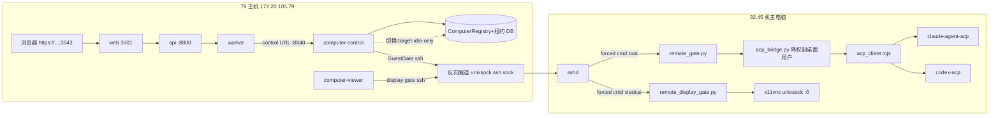

# KAI 电脑演示一条龙：前置调研 · 架构 · 剧本 · 验收回滚（2026-11-05）

对应计划 `docs/plans/2026-11-05-kai-computer-demo-pipeline.md` D0.5。合稿依据：
D0 结果 `2026-11-05-acp-demo-writable.md`、代码 `src/harness/computer/*`（本工作树
`fix/local-computer-link-20261104`）、79 现网实测（2026-11-05）。**只含可核验事实**；
没实测的地方明确写「未验证」。

---

## 一、前置技术调研

### 1.1 ACP 可写：mode 与 permission 的真实语义（D0 落地版）

| 项 | D0 之前（只读版，commit 5acf4458） | D0 之后（DEMO 可写，03db5621） |
|---|---|---|
| mode | 强制 `session/set_mode`：claude→`plan`、codex→`read-only`；不支持的 mode 直接失败 | **不设 mode**。各 agent 用机主自己登录态的默认模式；结果里 `mode` 字段如实回报实际值 |
| permission | `session/request_permission` 一律 `{"outcome":{"outcome":"cancelled"}}` | 优先 `options[].kind=="allow_once"`，兜底 `allow_selected`/`allow_always` 的 optionId，但 **outcome 永远 `allow_once`**（单次放行，绝不记忆） |
| 结果标记 | `read_only: true` | `demo_writable: true` + `mode` |
| 文案 | 「仅只读调研；权限请求拒绝」 | 「【DEMO 可写】权限请求按 allow_once 放行（仅本次，不记忆）」 |

**为什么不猜可写 modeId**：`claude-agent-acp` / `codex-acp` 的实际 mode 清单随版本与用户
本地设置变化，写代码时 32.45 不可达无法实测。错误 modeId 会让 `set_mode` 直接抛错（旧代码
注释就写明「Unsupported modes must fail」）。**去掉 set_mode 是当前唯一不赌版本的做法**；
等 32.45 恢复后可在真机上枚举 `session/modes`（ACP 标准字段）补实测，届时若要收紧可恢复
set_mode 并用实测 id。

**与 11.20 只读文档的关系**：D0 前的只读语义（cancelled + 强制 mode）来自 11.17–11.20
remote-computer 交付线；本次是**演示期覆盖**，不是替代——回滚方式见第四节，git 一键恢复。

**Codex/Claude 实测边界（如实）**：真实 ACP 调用当天被 gate 摘要校验挡住（见 1.4），
因此「agent 拿到 allow_once 后是否真的写文件」**尚未在真机验证过**。已验证的是：
control 侧链路、client 代码形态、单测断言（`tests/unit/sandbox/test_acp_connector.py` 19 项）。

### 1.2 本机 enrolled gate vs 云 vm-computer vs remote-computer

| 维度 | 本机 enrolled gate（32.45 线） | 云电脑（vm-computer） | remote-computer（通用定义） |
|---|---|---|---|
| 本质 | 用户自己的物理机 + 出站反向隧道 + 固定命令 gate | 79 上 QEMU/KVM 跑的 qcow2 VM（3.3G guest 盘） | 上述两者的统称 provider（`remote-computer`） |
| 桌面 | 机主真实桌面（x11vnc unixsock） | VM 内合成桌面 | — |
| 身份 | `/etc/kai-computer-remote.json`：machine_id+computer_id+**image 摘要**（gate 文件哈希） | guest_base_digest=VM 基像摘要 | 每台一个 digest，control 逐台 pin |
| 登录 | 复用机主 Claude/Codex 已登录账号（HOME=桌面用户） | VM 内预置账号 | — |
| 生命周期 | 永不关机；gate 只 drain KAI 进程 | 可 start/reset | — |
| 79 现状 | 已注册（`recovering`，见 1.4 阻塞） | **未部署**（computer-desktop 容器 79 有、116 无；guest qcow2 未搬 116） | — |

**vm-computer 与 remote-computer 在代码里同源**：`RemoteComputerSpec`（remote.py）与
`SshComputerSpec`（vm_host.py）都走 `GuestGate` + 强制命令 SSH；差别在生命周期
（VM 可 reset/重启，物理机只 drain）与桌面来源（qcow2 vs 机主 X11）。

### 1.3 79 现网镜像与健康（2026-11-05 实测）

| 容器 | 镜像 | 状态 |
|---|---|---|
| api / worker | `kai/superagent-api:20261104-stale-send-ed6252ec` | healthy（Up 5h） |
| web | `kai/superagent-web:20261104-bot-working-530f1bae` | healthy |
| computer-control | `kai/computer-control:20261104-acp-demo-03db5621`（D0 叠加镜像） | **healthy**（D1 复核通过；昨日曾因 `BlockingIOError` 进程耗尽卡死，重启恢复——复发型，非代码缺陷） |
| computer-viewer | `kai/computer-viewer:20261103-native-desktop-v2` | Up 29h |
| feishu / weixin | `20261102-4aaedddf` / `20261102-d78a8d5a` | 未动（Up 47h / 2d） |

**BlockingIO 类故障备注**：computer-control 的 unhealthy 是 uvloop `create_subprocess_exec`
资源耗尽（`BlockingIOError: Errno 11`），`docker restart` 即恢复；若复现且频繁，D1+ 应查
子进程泄漏（每次 gate 调用一个 ssh 进程，租约风暴时可能堆积）。

### 1.4 当前阻塞：control gate identity 被 refuse（ digest 不一致三say）

control 经隧道向本机 gate 发 `{"action":"identity"}` 得到
`Computer remote control refused the request.`（exit 125，gate 捕获异常后的统一出口）。
**证据链**：
- 隧道活着（unix socket `ssh.sock` 直接握手返回 OpenSSH banner）；
- viewer 身份同样能执行 gate python（`remote_display_gate.py` 报 ConnectionReset 是下游
  VNC socket 未启动，属正常——桌面服务没起）；
- 因此 refuse 发生在 `remote_gate.configuration()`：
  a) `image` 摘要 ≠ 机内 gate 文件实哈希，或 b) `machine_id` ≠ `/etc/machine-id`。
- **摘要三方不一致**（实测）：control 环境声明 `3434b9f0…`；机内
  `/etc/kai-computer-remote.json` 写 `dac63fd8…`（10-27 登记）；D0 当天实测机内 4 文件
  哈希 `29e2e2a2…`（repo HEAD 4 文件为 `0b746c3d…`，5 文件 `1aa237ff…`，均对不上任何一方）。
- **结论**：机内 gate 文件或配置有一方漂移；修复必须在 32.45 直连 SSH 恢复后做
  （重算哈希 → 更新 `/etc/kai-computer-remote.json` 的 `image` → 与 control env 的
  `guest_base_digest` 对齐）。**D2 本机冒烟在该修复前无法通过**，不假报。

---

## 二、架构说明

### 2.1 组件与职责

```
主助理会话（/assistant）
   │  派活（@编码协同 / ui.handover）
   ▼
编码协同 Bot（specialist 线程，assistantScope）
   │  工具调用 computer_*（computer_ui / computer_acp / 文件）
   ▼
Worker（kai/superagent-api 容器内 runtime）
   │  HARNESS_ASSISTANT_COMPUTER_CONTROL_URL → computer-control:8840
   ▼
computer-control（独立容器，持 registry + 租约 + 驱动）
   │  GuestGate.call(action, spec)   ← 每次一个 ssh 进程，stdin 传 JSON
   ▼  ProxyCommand=socket_proxy.py /remote-transport/ssh.sock（反向隧道 unix socket）
32.45 sshd ── forced command ──> sudo python3 -I /opt/kai-computer/remote_gate.py
   │                                （root，digest 校验后执行）
   ├── remote_gate.py：identity / activate / deactivate / acp / native_desktop
   │     └── acp → acp_bridge.py（drop to 桌面用户 uid，PR_SET_NO_NEW_PRIVS）
   │             └── node acp_client.mjs（claude-agent-acp / codex-acp 子进程）
   └── remote_display_gate.py：viewer 的 RFB unixsock 中继（仅桌面画面）
```

### 2.2 关键机制（代码出处）

- **ComputerRegistry / opaque target**：用户侧只见 `target_id`（如 `cloud`/`local`）与
  `binding_key`；`ComputerTargetService.view()` 只回 label/binding，绝不暴露 provider
  端点、卷路径或 computer_id（`targets.py` 头注释）。切换 = registry 原子操作
  （idle-only，活跃时 409「电脑正在使用中」）。
- **租约 · epoch · 接管**：`DesktopControlService`（desktop.py）维护
  `OBSERVE/AGENT/HUMAN` 三态；`acquire_agent` 只在 OBSERVE 可得；每次易主 `epoch+=1`，
  每个 GUI 动作绑定 `expected_epoch`，旧持有者动作被拒（`ComputerLeaseLostError`）。
  人工接管写 HUMAN + epoch+1，agent 立即失效；`release_agent` 归还 OBSERVE。
  职责级排队在 `acquire_desktop_turn`（优先级+FIFO，30s 宽限软抢占，不硬打断）。
- **执行绑定 vs 仅查看**：`computer-viewer` 只走 `remote_display_gate.py`（画面只读中继）；
  执行（computer_ui/computer_acp）走 control identity + control 身份的 gate。两条 SSH
  身份、两条 authorized_keys，互不越权。
- **ACP 桌面用户 HOME**：`acp_bridge.run()` 用 `preexec_fn` 依序
  `PR_SET_NO_NEW_PRIVS` → `setgroups([])` → `setgid/setuid(桌面uid)`；env 只有
  HOME/USER/LOGNAME/LANG/PATH。所以 Claude/Codex 看到的是**机主自己的登录态与配置**
  （`~/.claude`、`~/.codex`），凭据不复制、不给 root。
- **digest pin**：gate 每次 `configuration()` 重算
  `[remote_display_gate, remote_gate, ssh_gate, supervisor(, native_desktop)]` 的
  sha256，与 `/etc/kai-computer-remote.json` 的 `image` 比对，且要求该文件 root:root
  0644；`acp_client.mjs` / `acp_bridge.py` **不在** digest 里（可独立替换），bridge 由
  gate 动态 import 仍是 root-owned 校验路径。

### 2.3 mermaid 总图



**切云（vm-computer）时**：同一 REG/租约语义，GuestGate 走 VM 容器 ssh（22 端口映射
127.0.0.1:22081），桌面来自 qcow2 VM；`computer-desktop` 容器 79 已具备，116 未搬。

---

## 三、演示剧本（每步：操作 → 预期 → 失败判读）

> 前提：D2 阻塞修复完成（32.45 可 SSH，digest 对齐，identity 通过）。每步的「失败判读」
> 给出第一排查点，避免现场瞎猜。

**S0 历史可见**
- 操作：打开 `/assistant` → rail 点「编码协同」。
- 预期：旧对话历史在（binding 修复后）。
- 判读：历史空 → 查 `agui_thread_bindings` 该 specialist 的 session 绑定。

**S1 打开电脑面板（本机）**
- 操作：页头「打开电脑」→ 默认 target=本机。
- 预期：右侧桌面画面（机主 :0 实时）。
- 判读：黑屏/断开 → `journalctl -u kai-remote-display`（x11vnc 起没起）+ viewer 日志
  `ConnectionReset`（=VNC socket 不存在）。

**S2 DEMO 可写 ACP（核心演示点）**
- 操作：在编码协同会话让 Bot「用 computer_acp 在 ~/demo.txt 写一行字并读回」。
- 预期：工具调用卡片显示 `computer_acp`，结果 `ok:true` + 写读内容一致；
  `denied_permissions` 为空，`mode` 字段有真实值。
- 判读：
  - `ACP_LOGIN_REQUIRED` → 机主 Claude/Codex 未登录；
  - permission 卡住 → client 的 allow_once 未生效（查 gate 里 acp_client.mjs 版本）；
  - `refused` → digest 未对齐（见 1.4 修复步骤）。

**S3 切到云电脑**
- 操作：targets 下拉选 `cloud`（需 idle）。
- 预期：切机成功提示；桌面变为 VM 画面；`hostname` 回显 VM 容器名。
- 判读：409「电脑正在使用中」→ 有活跃 Run 占用，等终态；VM 黑屏 → 查
  `computer-desktop` 容器与 qcow2 clone 盘。

**S4 切回本机 + 人工接管**
- 操作：切回 `local`；演示中点「接管」。
- 预期：接管瞬间 Bot 的 `computer_ui` 动作被拒（epoch 变更提示）；交还后恢复。
- 判读：Bot 仍能操作 → epoch 校验失效（严重，需查 `expected_epoch` 传递）。

**S5 回执链路**
- 全程：主会话该轮下应有一行「已发送消息给 编码协同」且**只有一条**（ff383602 的
  去重修复，79 当前 web 是 bot-working-530f1bae——**注意**：该修复随 ff383602 回滚
  暂不在 79 上，S5 此项演示时如实说明或单独重滚该单点修复）。

---

## 四、验收与回滚

### 4.1 镜像与验收命令（79）

```bash
# 组件版本
docker ps --filter name=kai-79-20261013 --format '{{.Names}} {{.Image}} {{.Status}}'
# 期望：api/worker=20261104-stale-send-ed6252ec, web=20261104-bot-working-530f1bae,
#       computer-control=20261104-acp-demo-03db5621, feishu/weixin=20261102-*
# ACP 文案（容器内只读断言）
docker exec kai-79-20261013-computer-control-1 python -c "
import inspect, harness.computer.acp_tools as t
src=inspect.getsource(t); assert '只读' not in src and 'DEMO 可写' in src; print('ok')"
# client 形态
docker exec kai-79-20261013-computer-control-1 sh -c \
  "grep -c allow_once /app/project/lib/python3.12/site-packages/harness/computer/acp_client.mjs"  # ≥6
# HTTP
curl -sk -o /dev/null -w '%{http_code}\n' https://172.20.105.79:3543/assistant   # 200
curl -s -o /dev/null -w '%{http_code}\n' http://127.0.0.1:8080/healthz           # 200
# D1 identity（真实 gate 调用；digest 修复后应返回 machine_id/computer_id/image JSON）
```

### 4.2 退回只读（两步，均可独立做）

```bash
# ① 79 容器回退（computer-control 一个容器）
cd /data/kai-79-20261013-acp-demo-03db5621 && docker compose \
  --project-directory /data/kai-79-20261013 -f compose.release.json \
  up -d --no-deps --pull never computer-control
# ② 机主电脑 client 回退只读版（5acf4458）
sudo install -m 644 -o root -g root <(git -C <repo> show 5acf4458:src/harness/computer/acp_client.mjs) \
  /opt/kai-computer/acp_client.mjs
```
或 `git revert 03db5621`（代码层）。回滚后工具描述恢复「仅只读调研」，permission 恢复一律拒绝。

### 4.3 D2 阻塞修复清单（演示前必做，机器侧）

1. 32.45 SSH 恢复后重算 gate 摘要：`cat /opt/kai-computer/{remote_display_gate,remote_gate,ssh_gate,supervisor,native_desktop}.py | sha256sum`（native_desktop 启用时 5 文件）；
2. `/etc/kai-computer-remote.json` 的 `image` 更新为该值，同时确认 `"acp": true`；
3. control 侧 `HARNESS_COMPUTER_CONTROL_REMOTE_COMPUTERS[0].guest_base_digest` 改成同一值
   （compose env，改后 `up -d computer-control`）——**两处必须同值**，identity 才能过
   （`remote.py: identity == expected`）；
4. 刷 `/opt/kai-computer/acp_client.mjs` 为 `03db5621` 版（不在 digest 内，单独替换即可）；
5. 冒烟 identity：第四节命令，期望返回 `{"machine_id":...,"computer_id":...,"image":...}`。

---

## 五、D1 复核结论（本片完成）

- computer-control `20261104-acp-demo-03db5621` **healthy**（昨日 BlockingIO 卡死为复发型，
  重启恢复；若再发应查子进程泄漏）→ **D1 通过**（identity 冒烟仍被 1.4 digest 阻塞，
  依赖 D2 修复清单第 1–3 步）。
- D2：本机冒烟步骤已起草（三节 S2 + 4.3 清单），等 32.45 网络恢复执行。

## 六、已知缺口（不掩盖）

1. ff383602 的 web 修复（@ 回执去重等）随紧急回滚不在 79 上——演示 S5 该点需单独重滚或演示时如实说明。
2. 云电脑演示（S3）未在 116/79 双端验证过 qcow2 clone（79 有容器与盘，未演练切机）。
3. ACP 真机写入从未跑通过（gate digest 阻塞在前），S2 的「写文件成功」当前是**预期**而非实测。
4. `claude-agent-acp`/`codex-acp` 的 mode 枚举未实测；若后续要恢复强制 mode，需真机枚举后回填。
