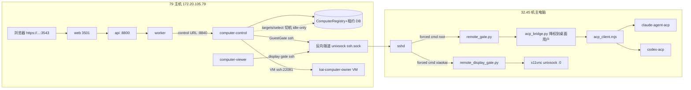

# KAI 电脑演示脚本（最终版）：前置调研 · 架构 · S0–S5 跟点 · 验收回滚

对应计划 `docs/plans/2026-11-05-kai-computer-demo-pipeline.md` D4（D0–D3 全部 ✅）。
本文是**用户可只读跟点一遍**的最终演示脚本；每个演示步骤都嵌入了 D2/D3 真实 Run 的
锚点（run id / 文件路径 / revision / hostname），预期即实测结果。证据档：
`2026-11-05-acp-demo-writable.md`（D0）、`2026-11-05-kai-computer-local-smoke.md`（D2）、
`2026-11-05-kai-computer-cloud-smoke.md`（D3）。

演示环境：**79 = `https://172.20.105.79:3543/assistant`**（自签证书需手动信任）。

---

## 一、前置技术调研（讲清「为什么它这样工作」）

### 1.1 ACP 可写：mode 与 permission 语义（D0 落地，已被 D2 实证）

| 项 | D0 之前（只读版，5acf4458） | D0 之后（DEMO 可写，03db5621/9ed42ee1） |
|---|---|---|
| mode | 强制 `session/set_mode`：claude→`plan`、codex→`read-only`；不支持的 mode 直接失败 | **不设 mode**，agent 用机主登录态默认模式；结果 `mode` 字段如实回报（当前实测为 `null`） |
| permission | `session/request_permission` 一律 `cancelled` | 按 `options[].kind=="allow_once"` 优先选取（`9ed42ee1` 起回 `selected`+`optionId`），**outcome 永远单次放行，绝不记忆** |
| 结果标记 | `read_only: true` | `demo_writable: true` + `mode` + `denied_permissions`（请求过清单） |
| 文案 | 「仅只读调研；权限请求拒绝」 | 「【DEMO 可写】权限请求按 allow_once 放行（仅本次，不记忆）」 |

**实测边界（已闭合）**：D2 产品路径真实 Run（`run_d741a8b5…`）经 computer_acp 完成写入
并读回一致；用户已在页上复验同一结果。三项历史缺口全部关闭，剩余只有 `mode` 字段为
`null`（如实展示，ACP 客户端未上报 mode id）。

### 1.2 三种电脑形态：本机 enrolled gate vs 云 vm-computer

| 维度 | 本机（`local-32-45`，remote-computer） | 云电脑（`cloud`，vm-computer） |
|---|---|---|
| 本质 | 机主物理机 + 出站反向隧道 + 固定命令 gate | 79 上 QEMU/KVM qcow2 VM（`kai-computer-owner-preview-20261027` 容器，Up 7d） |
| 桌面 | 机主真实桌面（x11vnc unixsock） | VM 内桌面 |
| 登录态 | 复用机主 Claude/Codex 登录（HOME=桌面用户 xiaokai） | VM 内预置账号 |
| 身份 pin | `/etc/kai-computer-remote.json` `image`=gate 文件哈希 `72b329d6…` | `guest_base_digest=c50f2f98…` |
| 生命周期 | 永不关机，gate 只 drain KAI 进程 | 可 start/reset |
| 演示实证 | D2 ✅（ACP 写读） | D3 ✅（hostname=VM 机名） |

### 1.3 79 现网快照（演示当天基线，健康）

| 容器 | 镜像 | 状态 |
|---|---|---|
| api / worker | `kai/superagent-api:20261104-stale-send-ed6252ec` | healthy |
| web | `kai/superagent-web:20261104-bot-working-530f1bae` | healthy |
| computer-control | `kai/computer-control:20261104-acp-demo-03db5621` | healthy |
| computer-viewer | `kai/computer-viewer:20261103-native-desktop-v2` | Up 30h |
| feishu / weixin | `20261102-4aaedddf` / `20261102-d78a8d5a` | 未动 |

**BlockingIO 备注**：computer-control 曾因 uvloop 子进程资源耗尽卡死（`Errno 11`），
`docker restart` 即恢复；复发时先重启再查泄漏。

### 1.4 gate digest：曾经的阻塞 → 已对齐

历史：control 声明 `3434b9f0…`、机内配置 `dac63fd8…`、实测机内文件 `29e2e2a2…` 三方不一致，
gate `configuration()` 一律 refuse。**现已解决**：机内配置与 control env 双侧对齐为
`sha256:72b329d672a3ed9aa8d590f667ff63a72c537dc3fb40372f7fca310c11157f50`（×5 台 remote
声明同步），control gate identity **经 kai-control PASS**；修复清单存档于 §4.3。
若演示现场 identity 再 refused，第一排查点就是「机内 gate 文件是否被改动而摘要没同步」。

---

## 二、架构说明

### 2.1 组件链路

```
主助理会话（/assistant）
   │  派活（@编码协同 / ui.handover）
   ▼
编码协同 Bot（specialist 线程，assistantScope）
   │  工具调用 computer_*（computer 文件/终端、computer_ui、computer_acp）
   ▼
Worker（kai/superagent-api 容器内 runtime）
   │  HARNESS_ASSISTANT_COMPUTER_CONTROL_URL → computer-control:8840
   ▼
computer-control（独立容器：registry + 租约 + 驱动）
   │  GuestGate.call(action, spec) —— 每次 gate 调用一个 ssh 进程，stdin 传 JSON
   ▼  ProxyCommand=socket_proxy.py /remote-transport/ssh.sock（反向隧道）
32.45 sshd ── forced command ──> sudo python3 -I /opt/kai-computer/remote_gate.py
   ├── remote_gate.py：identity / activate / deactivate / acp / native_desktop
   │     └── acp → acp_bridge.py（降权到桌面用户，PR_SET_NO_NEW_PRIVS）
   │             └── node acp_client.mjs → claude-agent-acp / codex-acp
   └── remote_display_gate.py：viewer 的 RFB unixsock 中继（只出画面）
```

### 2.2 关键机制（含 D2/D3 实证语义）

- **一人一台 · opaque target · 切机=换底层 computer（D3 实证）**：用户只见 `target_id`
  （`cloud` / `local-32-45`）与 label，不见端点/卷/computer_id。`targets/select` 在
  **idle-only** 下原子切换；registry 行 `computer_76649d1de938…` 的 provider 直接从
  remote-computer（rev 379→385 时变 vm-computer）换回（rev 391），**target 列表本身不变**。
  活跃 Run 期间切换 409「电脑正在使用中」（D2 当天实证过一次：上一 run 的桌面 agent 租约
  epoch 213 过期前 10s 仍 409，等 15s 过期后成功——**租约过期自动释放，不要手工清 DB**）。
- **租约 · epoch · 接管**：`OBSERVE/AGENT/HUMAN` 三态；agent 只在 OBSERVE 可得；每次易主
  `epoch+=1`，GUI 动作绑定 `expected_epoch`，旧持有者被拒（`ComputerLeaseLostError`）。
  人工接管写 HUMAN + epoch+1，agent 立即失效；交还归 OBSERVE。
- **执行绑定 vs 仅查看**：viewer 只走 `remote_display_gate.py`（画面只读中继）；执行走
  control 身份的 gate。两条 SSH 身份、两条 authorized_keys，互不越权。
- **两条执行通道的话术区分（D3 关键发现，演示必讲）**：
  - `computer_acp`（本机）＝机主桌面用户身份下的 Claude/Codex 子代理——**写的就是机主
    机器、用的是机主登录态**（D2：`execution_user=xiaokai`，写入 `/home/xiaokai/acp-test/`）。
  - 云上的 Bash/文件工具＝**沙箱策略内执行**（D3 实测 `tool.allowed` policy=
    `production-orchestrator`，而非电脑直控）——话术说「在云电脑环境里跑命令」，不要说
    「电脑直控」。
- **ACP 降权**：bridge `PR_SET_NO_NEW_PRIVS`→`setgroups([])`→`setgid/setuid`，env 仅
  HOME/USER/LOGNAME/LANG/PATH——Claude/Codex 看到机主登录态，凭据不复制、不给 root。
- **digest pin**：gate 每次重算
  `[remote_display_gate, remote_gate, ssh_gate, supervisor, native_desktop]` sha256 与
  `/etc/kai-computer-remote.json` 的 `image` 比对；`acp_client.mjs`/`acp_bridge.py`
  **不在** digest 内（可独立替换）。

### 2.3 mermaid 总图



---

## 三、演示剧本 S0–S5（操作 → 预期（含实测锚点） → 失败判读）

> 全程锚点均为 2026-11-05 真实实测值；现场重跑时数值会变，但**形态**应一致。

### S0 打开助手，历史可见

- **操作**：打开 `https://172.20.105.79:3543/assistant` → rail 点「编码协同」。
- **预期**：旧对话历史在；发送一句话 Bot 正常回复。
  - 实测锚点：`run_5e3586a8…` succeeded，Bot 正常回话（用户页上已复验）。
  - 
- **失败判读**：历史空 → 查 `agui_thread_bindings` 里该 specialist 的 session 绑定；
  回复失败 → 看 `runs.payload` 的 error。

### S1 打开电脑面板（本机画面）

- **操作**：页头点「打开电脑」→ 右侧分栏出现，target 默认本机。
- **预期**：右侧显示机主 :0 实时桌面。
  - 
- **失败判读**：黑屏/断开 → `journalctl -u kai-remote-display`（x11vnc 起没起）；
  viewer 日志 `ConnectionReset` = VNC socket 不存在（桌面服务没起）。

### S2 本机 DEMO 可写 ACP（核心演示点）

- **操作**：在编码协同会话发：「用 computer_acp（claude）在 /home/xiaokai/acp-test 目录
  创建 D2_PRODUCT_ACP.txt，内容一行 D2_ACP_OK，然后读回确认。」
- **预期**（D2 实测锚点 `run_d741a8b5…` succeeded）：
  - 工具卡片 `computer_acp`；回执 `ok:true`、`demo_writable:true`、
    `execution_user=xiaokai`、`cwd=/home/xiaokai/workspace/KAI`；
  - 文本里两次出现命令痕迹：`printf 'D2_ACP_OK\n' > …/D2_PRODUCT_ACP.txt` 与
    `cat` 输出 `D2_ACP_OK`；
  - `denied_permissions` 含 mkdir/printf/cat 三条——**这是「请求过」清单不是拒绝**，
    对照 `tools[]` 三个 Terminal 全部完成即为放行生效；
  - `mode: null` 如实展示。
  - 
- **失败判读**：
  - `ACP_LOGIN_REQUIRED` → 机主 Claude 未登录；
  - permission 卡住不返回 → gate 里 `acp_client.mjs` 版本旧（无 allow_once）；
  - `refused`/exit 125 → gate digest 漂移（按 §4.3 清单重新对齐）；
  - 回执 `ok:false` 且 text 空 → 看 control 日志，勿假报成功。

### S3 切到云电脑并执行

- **操作**：targets 下拉选「云电脑」→ 在会话发：「查一下当前电脑的 hostname 并原样告诉我」。
- **预期**（D3 实测锚点 revision 385→`run_f6323257…` succeeded）：
  - 切机成功提示（target 列表不变，底层 computer 已换）；
  - Bash 结果：`kai-aaaaaaaaaaaaaaaaaaaa` + `hostnamectl` 显示 `Chassis: vm`——
    证明跑在云 VM 而非本机；
  - 
- **话术提醒**：云上的 Bash 走沙箱策略（`tool.allowed`，policy=production-orchestrator），
  不是电脑直控；`computer_acp`（Claude/Codex 登录态）目前只在本机 gate 配置了。
- **失败判读**：409「电脑正在使用中」→ 有活跃 Run/租约，等终态（过期自动释放）；
  VM 无响应 → 查 `kai-computer-owner-preview-20261027` 容器（应 Up）。

### S4 切回本机 + 人工接管

- **操作**：targets 选回「本地电脑」→ 演示中点「接管」→ 再「交还」。
- **预期**：切回成功（D3 实测 revision 391，registry 回 remote-computer/registered）；
  接管瞬间 Bot 的桌面动作被拒（epoch 变更提示）；交还后恢复。
  - 
- **失败判读**：接管后 Bot 仍能操作 → epoch 校验失效（严重，查 `expected_epoch` 传递）。

### S5 回执链路

- **全程**：主会话该轮下一行「已发送消息给 编码协同」，**只有一条**——去重
  （`liveMentionsForThread` 本会话过滤 + 只渲染最新一条）已在 79 现网 web
  （`bot-working-530f1bae` 构建自本分支 530f1bae 树）内，已核实。
  - 
- **失败判读**：出现多条 → 核对线上 web 镜像 tag 是否被换回旧版。

---

## 四、验收与回滚

### 4.1 验收命令（演示前 5 分钟过一遍）

```bash
# 组件版本（期望见 §1.3 表）
docker ps --filter name=kai-79-20261013 --format '{{.Names}} {{.Image}} {{.Status}}'
# ACP 文案（容器内只读断言，期望 ok）
docker exec kai-79-20261013-computer-control-1 python -c "
import inspect, harness.computer.acp_tools as t
src=inspect.getsource(t); assert '只读' not in src and 'DEMO 可写' in src; print('ok')"
# client 形态（期望 ≥6）
docker exec kai-79-20261013-computer-control-1 sh -c \
  "grep -c allow_once /app/project/lib/python3.12/site-packages/harness/computer/acp_client.mjs"
# HTTP（均期望 200）
curl -sk -o /dev/null -w '%{http_code}\n' https://172.20.105.79:3543/assistant
curl -s -o /dev/null -w '%{http_code}\n' http://127.0.0.1:8080/healthz
# identity（期望 {"machine_id":...,"computer_id":...,"image":...} JSON；见 D0/D1 档）
```

### 4.2 退回只读（两步，均可独立做）

```bash
# ① 79 容器回退（只动 computer-control）
cd /data/kai-79-20261013-acp-demo-03db5621 && docker compose \
  --project-directory /data/kai-79-20261013 -f compose.release.json \
  up -d --no-deps --pull never computer-control
# ② 机主电脑 client 回退只读版（5acf4458）
sudo install -m 644 -o root -g root \
  <(git -C <repo> show 5acf4458:src/harness/computer/acp_client.mjs) \
  /opt/kai-computer/acp_client.mjs
```
或代码层 `git revert 03db5621`。回滚后描述恢复「仅只读调研」、permission 恢复一律拒绝。
注意 `acp_client.mjs` 不在 gate digest 内，单独替换不影响 identity。

### 4.3 digest 对齐清单（存档；已全部完成，供复发时照做）

1. 32.45 上重算摘要（native_desktop 启用为 5 文件）：
   `cat /opt/kai-computer/{remote_display_gate,remote_gate,ssh_gate,supervisor,native_desktop}.py | sha256sum`
   → 当前值 `72b329d672a3ed9aa8d590f667ff63a72c537dc3fb40372f7fca310c11157f50`；
2. `/etc/kai-computer-remote.json` 的 `image` 改为该值（确认 `"acp": true`）；
3. control env `HARNESS_COMPUTER_CONTROL_REMOTE_COMPUTERS[*].guest_base_digest` 改同一值
   （×5 声明），`up -d computer-control`——**两处必须同值**；
4. `/opt/kai-computer/acp_client.mjs` 刷成 `9ed42ee1` 版（不在 digest 内）；
5. identity 冒烟（§4.1 最后一行），期望返回 identity JSON。

---

## 五、环验收结论（D0–D3 全部 ✅）

| 环 | 结果 | 证据 |
|---|---|---|
| D0 DEMO 可写 | ✅ | `03db5621` + control `acp-demo-03db5621`；单测 19 过 |
| D0.5 调研+架构 | ✅ | 本档前身（D0.5 版） |
| D1 control 健康 | ✅ | healthy；BlockingIO 复发时重启恢复（复发应查泄漏） |
| D2 本机 ACP 写入 | ✅ | `run_d741a8b5…` 写读 `D2_PRODUCT_ACP.txt`=`D2_ACP_OK`；页上复验通过 |
| D3 云切换执行 | ✅ | rev 385→391；`run_f6323257…` 云 VM hostname=`kai-aaaa…` |
| D4 本脚本 | ✅ | 本文（S0–S5 可跟点） |

## 六、已知缺口（演示时如实，不掩盖）

1. **viewer 桌面画面彩排可选**：S1/S3 的画面未做过正式彩排（执行链路已验），演示前建议
   各开一次面板确认画面。
2. **`mode` 字段为 `null`**：ACP 客户端未上报 mode id；如需收紧权限模式，须真机枚举
   `session/modes` 后回填强制 set_mode。
3. **`denied_permissions` 是请求清单不是拒绝记录**：讲解时按 §三 S2 口径说明。
4. 云上 Bash 走沙箱策略、`computer_acp` 只在本机 gate 配置——两通道能力边界见 §2.2。
